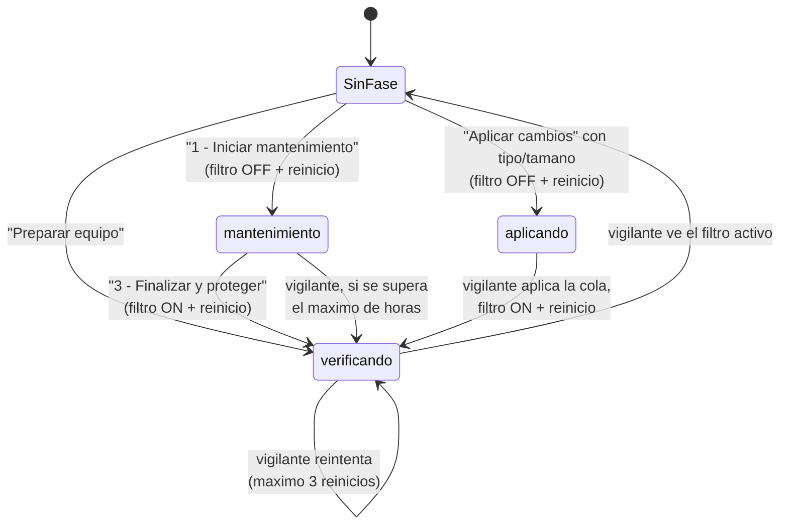

# Como funciona UWFManager

Este documento explica el funcionamiento interno de la herramienta: que piezas tiene, como
decide lo que hace en cada momento y que garantias da para que un equipo del aula no se
quede sin proteccion. Para una vista rapida de las funciones y de como compilar, ver el
[README](../README.md).

## Indice

1. [Idea general](#1-idea-general)
2. [Piezas](#2-piezas)
3. [Como lee y como actua sobre UWF](#3-como-lee-y-como-actua-sobre-uwf)
4. [Instalacion y actualizacion en cada equipo](#4-instalacion-y-actualizacion-en-cada-equipo)
5. [La cola de cambios pendientes](#5-la-cola-de-cambios-pendientes)
6. [Fases y vigilante](#6-fases-y-vigilante)
7. [Exclusiones](#7-exclusiones)
8. [Uso del disco (overlay)](#8-uso-del-disco-overlay)
9. [Perfiles](#9-perfiles)
10. [La interfaz, pestana a pestana](#10-la-interfaz-pestana-a-pestana)
11. [Ficheros que guarda en el equipo](#11-ficheros-que-guarda-en-el-equipo)
12. [Registro (log)](#12-registro-log)
13. [Garantias de seguridad](#13-garantias-de-seguridad)
14. [Diagnostico de problemas](#14-diagnostico-de-problemas)
15. [Limitaciones conocidas](#15-limitaciones-conocidas)

---

## 1. Idea general

El **Unified Write Filter (UWF)** de Windows redirige todas las escrituras en el disco
protegido a una zona temporal (el *overlay*) que se vacia al reiniciar. El equipo vuelve
siempre al mismo estado, pero eso tambien impide instalar actualizaciones o cambiar la
configuracion de forma permanente.

UWF trae un *servicing mode* para eso, pero es fragil y no cubre el software de terceros.
UWFManager lo sustituye por un flujo mas simple y vigilado:

- Para cambiar algo de forma permanente se **desactiva el filtro**, se reinicia, se trabaja
  y se **vuelve a activar**.
- Una **tarea programada** (el *vigilante*) comprueba en cada arranque que la proteccion ha
  vuelto y la reactiva sola si alguien se olvida.
- Los cambios de configuracion de UWF (exclusiones y uso del disco) **no se aplican al
  momento**: se encolan y se aplican de una vez con un solo boton.

## 2. Piezas

```
+--------------------------+        +----------------------------+
|  Interfaz (tecnico)      |        |  Vigilante (SYSTEM)        |
|  UWFManager.exe          |        |  misma app, --vigilante    |
|  o UWF-Aulas.ps1         |        |  en cada arranque          |
+------------+-------------+        +-------------+--------------+
             |  lee / escribe                     |  lee / escribe
             v                                    v
      +-------------------------------------------------------+
      |  C:\ProgramData\UWF-Aulas\                            |
      |  config.json  estado.json  pendientes.json            |
      |  perfil-exclusiones.json  uwf-aulas.log  copia de app |
      +-------------------------------------------------------+
             |                                    |
             v                                    v
      +-------------------------------------------------------+
      |  UWF:  WMI (leer)          uwfmgr.exe (actuar)        |
      +-------------------------------------------------------+
```

- **Dos implementaciones con el mismo comportamiento**:
  - `UWF-Aulas.ps1`: PowerShell 5.1 + Windows Forms. No necesita instalar nada.
  - `UWF-Aulas.py`: Python + Tkinter, que se compila a `UWFManager.exe`. No necesita
    Python en el equipo destino.

  Ambas leen y escriben los mismos ficheros con el mismo formato, de modo que una cola de
  pendientes creada con una la entiende la otra. Cualquier cambio de logica tiene que
  hacerse en las dos.
- **Interfaz**: la usa el tecnico. Se abre sin argumentos y exige ser administrador.
- **Vigilante**: el mismo programa lanzado con `--vigilante` (o `-Vigilante` en el `.ps1`)
  por la tarea programada `UWF-Aulas-Vigilante`, como `SYSTEM`, en cada arranque. No tiene
  interfaz: todo lo que hace queda en el log.
- **Carpeta de trabajo** `C:\ProgramData\UWF-Aulas\`: el estado compartido entre la
  interfaz y el vigilante (ver [seccion 11](#11-ficheros-que-guarda-en-el-equipo)).

## 3. Como lee y como actua sobre UWF

| Para... | Se usa | Por que |
|---|---|---|
| Leer el estado (filtro, volumenes, overlay, exclusiones) | **WMI**, espacio `root\standardcimv2\embedded` (clases `UWF_Filter`, `UWF_Volume`, `UWF_OverlayConfig`, `UWF_Overlay`, `UWF_RegistryFilter`) | Da datos estructurados que no dependen del idioma de Windows. |
| Cambiar cosas (activar el filtro, anadir exclusiones, tamano...) | **`uwfmgr.exe`** | Es la herramienta oficial; se comprueba su codigo de salida. |
| Saber si la caracteristica UWF esta habilitada e instalarla | **`dism.exe`** con `/English` y, como respaldo, `Enable-WindowsOptionalFeature` | DISM no depende de PowerShell (que una politica puede restringir) y `/English` evita leer texto traducido. |

La salida de texto de `uwfmgr` solo se lee en dos casos de respaldo, cuando WMI no
responde: el consumo del overlay y la lista de exclusiones. En ambos se buscan numeros o
rutas, nunca frases, para no depender del idioma.

"UWF instalado" significa que existe `C:\Windows\System32\uwfmgr.exe`. En Windows Pro o
Home no existe, y casi todas las funciones avisan de que no se pueden usar.

## 4. Instalacion y actualizacion en cada equipo

Cada vez que se abre la interfaz (como administrador):

1. Si no existe `perfil-exclusiones.json`, se crea con el **perfil por defecto** definido en
   el codigo.
2. Se compara por **hash SHA-256** la copia instalada en `C:\ProgramData\UWF-Aulas\` con la
   que se esta ejecutando. Si son distintas, se sustituye. Como Windows no deja sobrescribir
   un ejecutable en uso, se intenta por este orden:
   1. copiar encima;
   2. terminar la tarea del vigilante (que suele tenerlo abierto) y copiar;
   3. renombrar la copia en uso a `.old-<fecha>` y copiar la nueva al lado. Los `.old-*`
      se borran en la siguiente ejecucion.
3. Se registra (o se vuelve a registrar) la tarea programada del vigilante.
4. Se crea el acceso directo `UWF Aulas.lnk` en el escritorio publico.

Si no se puede sustituir la copia instalada, la interfaz **lo avisa** y pide no usar
"Aplicar cambios y reiniciar": un vigilante antiguo no sabria cerrar la fase de aplicacion
de cambios (ver [seccion 6](#6-fases-y-vigilante)).

Por eso, **actualizar un equipo es solo ejecutar la version nueva una vez**.

### Primera puesta en marcha de un equipo

1. **Instalar caracteristica UWF** (pestana Estado). Habilita `Client-UnifiedWriteFilter`
   con DISM y pide reiniciar. Si la edicion de Windows no incluye UWF, lo dice claramente.
   El resultado se comprueba releyendo el estado, no fiandose solo del codigo de salida, y
   queda siempre en el log, tambien si falla.
2. **Preparar equipo** (pestana Estado). Protege el volumen `C:`, aplica el perfil de
   exclusiones guardado y activa el filtro. Si `uwfmgr` falla al proteger `C:` o al activar
   el filtro, se muestra el error y no se da el equipo por preparado. Tras activar el
   filtro deja la fase `verificando` para que el vigilante lo confirme en el arranque.

## 5. La cola de cambios pendientes

Todo lo que el tecnico configura en las pestanas **Exclusiones** y **Uso del disco** se
guarda en `pendientes.json` y **no llega a UWF hasta pulsar "Aplicar cambios y reiniciar"**
en la barra inferior, visible desde cualquier pestana.

Motivos:

- Se puede preparar todo, revisarlo y aplicarlo con un solo reinicio.
- La cola se ve aunque UWF todavia no este instalado en el equipo.
- Nada se queda a medias: lo que no se puede aplicar en ese momento sigue en la cola.

Reglas de la cola:

- **Se valida al encolar**, no al aplicar. Una ruta prohibida, una clave fuera de `HKLM` o
  unos umbrales incoherentes se rechazan en el momento en que el tecnico los elige.
- Las rutas y claves se comparan **sin distinguir mayusculas**, igual que Windows.
- **Encolar lo contrario anula**: si hay un "anadir X" pendiente y se pide "quitar X", los
  dos desaparecen y el equipo se queda como estaba.
- **Descartar** vacia la cola sin tocar el equipo.
- Si `pendientes.json` esta corrupto, se ignora en vez de bloquear la interfaz.

### Que pasa al pulsar "Aplicar cambios y reiniciar"

```
Hay que cambiar el tipo o el tamano del uso del disco con el filtro activo?
 |
 +-- NO --> se aplican exclusiones y umbrales
 |          --> se pregunta si reiniciar (1 reinicio)
 |
 +-- SI --> se aplican exclusiones y umbrales
            --> se desactiva el filtro, fase 'aplicando', reinicio (1)
            --> el vigilante aplica tipo y tamano, reactiva el filtro,
                fase 'verificando', reinicio (2)
            --> el vigilante confirma que el filtro esta activo y cierra la fase
```

Lo que UWF permite cambiar en cada situacion:

| Cambio | Con el filtro activo | Con el filtro desactivado |
|---|---|---|
| Anadir o quitar exclusiones | Si (surte efecto al reiniciar) | Si |
| Umbrales de aviso y critico | Si | Si |
| Tipo (RAM/Disco) y tamano del uso del disco | **No** | Si |

Si un cambio falla al aplicarse (por ejemplo, `uwfmgr` devuelve error), **se queda en la
cola** y el error se muestra y se registra.

## 6. Fases y vigilante

La "fase" en curso se guarda en `estado.json`. Si el fichero no existe, no hay ninguna
operacion abierta.



Que hace el vigilante en cada arranque:

| Fase | Situacion | Accion |
|---|---|---|
| ninguna | filtro activo | Nada. |
| ninguna | filtro desactivado | Anota un `AVISO` en el log (alguien lo desactivo fuera de la herramienta). |
| `mantenimiento` | | Si hay cola y el filtro esta desactivado, la aplica aprovechando el arranque sin proteccion. Si la ventana lleva abierta mas de las **horas maximas** (8 por defecto, configurable), reactiva el filtro, pasa a `verificando` y reinicia. Si no, anota cuanto lleva abierta. Aqui no reinicia por su cuenta, porque el tecnico puede estar trabajando. |
| `aplicando` | filtro desactivado | Aplica la cola, **reactiva el filtro aunque la cola falle**, pasa a `verificando` y reinicia. |
| `aplicando` | filtro activo (inesperado) | Anota un error y pasa a `verificando` sin tocar nada. |
| `verificando` | filtro activo | Lo confirma en el log y borra `estado.json`. |
| `verificando` | filtro desactivado | Reintenta activarlo y reinicia. **Como maximo 3 veces**: despues anota en el log que hace falta revisar el equipo y deja de reiniciar, para no dejarlo en un bucle de reinicios. |

Dos protecciones mas:

- Si `estado.json` no tiene una fecha de inicio legible, una ventana de mantenimiento se da
  por caducada y se reactiva la proteccion. Ante la duda, se protege.
- Cualquier error inesperado del vigilante se anota en el log; nunca muestra ventanas.

## 7. Exclusiones

Una exclusion es una carpeta, archivo o clave de registro que **no se protege**: lo que se
escribe ahi se conserva tras reiniciar. Sirve para lo que debe sobrevivir, como las firmas
del antivirus o la configuracion de un agente de gestion. Todo lo excluido queda expuesto
de una sesion a otra, asi que hay que **excluir lo minimo**.

### Lo que se ve en la pestana

Encima de la lista aparece un resumen con el numero de carpetas/archivos y claves que el
equipo tiene permitidas. La lista combina la cola y lo que ya esta en UWF, con este estado
en cada fila:

| Estado | Significado |
|---|---|
| `PENDIENTE: anadir` / `PENDIENTE: quitar` | En la cola, todavia sin aplicar. |
| `Permitida` | Excluida ahora y tambien despues de reiniciar. |
| `Permitida tras reiniciar` | Se anadio con el filtro activo: **aun no funciona**; funcionara tras reiniciar. |
| `Se quita al reiniciar` | Sigue funcionando en esta sesion, pero ya esta retirada. |

La columna **Existe** avisa si la ruta o la clave no existe en el equipo, que suele indicar
una exclusion obsoleta o mal escrita.

UWF guarda por separado las exclusiones de la sesion actual y las de la siguiente. La
herramienta las lee por WMI y las cruza para obtener esos estados. Si WMI no responde,
recurre a `uwfmgr` y, como entonces no puede distinguir las sesiones, las muestra todas como
`Permitida`.

### Reglas

- **Rutas prohibidas**: nunca se excluyen `C:\Windows\SoftwareDistribution`,
  `C:\Windows\WinSxS`, `C:\Windows\servicing`, `C:\$WINDOWS.~BT` ni
  `C:\Windows\System32\catroot2`, ni nada dentro de ellas. Excluirlas rompe Windows Update.
  La comprobacion se hace al encolar y otra vez al aplicar, venga la ruta de donde venga
  (a mano, por programa o desde un perfil).
- **Registro**: UWF solo admite claves bajo `HKLM`. Se aceptan las formas
  `HKLM\...`, `HKLM:\...` y `HKEY_LOCAL_MACHINE\...`, y se guardan como `HKLM\...`.

### Anadir por programa

El dialogo lista los programas instalados (leidos de las claves `Uninstall` del registro,
de 64 y 32 bits) y propone que excluir para el elegido:

1. **Catalogo**: si el programa casa con una entrada del catalogo (definido al principio de
   cada implementacion, por tipo de software: antivirus y su agente, gestor de login, el
   antivirus de Windows...), se proponen sus carpetas y claves, **solo las que existen** en
   el equipo, y aparecen **ya marcadas**.
2. **Heuristica**: si no esta en el catalogo, se buscan carpetas en `C:\ProgramData` y
   claves en `HKLM\SOFTWARE` (y `WOW6432Node`) cuyo nombre contenga palabras del nombre del
   programa o del fabricante. Para que no proponga medio sistema:
   - solo se usan palabras de 4 letras o mas;
   - se descartan palabras genericas ("Microsoft", "Windows", "Corporation", "Update",
     "Software"...);
   - nunca se proponen raices del sistema como `C:\ProgramData\Microsoft`,
     `HKLM\SOFTWARE\Microsoft`, `HKLM\SOFTWARE\Classes` o `HKLM\SOFTWARE\Policies`;
   - las propuestas aparecen **sin marcar**: el tecnico elige a conciencia.

Lo aceptado se encola como pendiente, igual que lo anadido a mano.

## 8. Uso del disco (overlay)

En la interfaz se llama "uso del disco" para que se entienda sin conocer UWF. Por dentro
(WMI, `uwfmgr` y los perfiles JSON) conserva el nombre de UWF: *overlay*.

- **Tipo**: `Disco` (reserva espacio en `C:`; recomendado, no resta memoria) o `RAM` (mas
  rapido, pero consume memoria segun se llena).
- **Tamano** en MB.
- **Umbrales** en MB: UWF avisa al llegar al de **aviso** y entra en estado critico al
  llegar al **critico**. Los dos miden **consumo acumulado**, no espacio libre, y deben
  cumplir:

  ```
  0 < aviso < critico <= tamano
  ```

  Esta regla se valida al encolar, al guardar un perfil y al leer la cola. Tenerlos
  invertidos fue un fallo real en una version anterior.

Los valores por defecto son Disco, 4096 MB, aviso 2560 MB y critico 3584 MB.

## 9. Perfiles

Un perfil es un JSON con un conjunto de exclusiones y, opcionalmente, la configuracion del
uso del disco:

```json
{
  "nombre": "Aulas - base",
  "version": "2026-10-28",
  "archivos": ["C:\\ProgramData\\Ejemplo"],
  "registro": ["HKLM\\SOFTWARE\\Ejemplo"],
  "overlay": { "tipo": "Disco", "tamanoMB": 4096, "avisoMB": 2560, "criticoMB": 3584 }
}
```

- **Perfil activo**: `C:\ProgramData\UWF-Aulas\perfil-exclusiones.json`. Lo usa
  "Preparar equipo".
- **Importar perfil**: valida los umbrales (si no cuadran, rechaza el perfil entero), lo
  guarda como perfil activo y **encola** todo su contenido como pendiente para revisarlo
  antes de aplicarlo.
- **Exportar perfil**: guarda en un JSON las exclusiones que el equipo tiene en UWF y la
  configuracion del uso del disco. Si no se ha podido leer esa configuracion completa, el
  perfil se exporta sin el apartado `overlay`.

Los perfiles propios de cada centro (con nombres de programas y rutas reales) no se suben
al repositorio: el `.gitignore` excluye `*.local.json`.

## 10. La interfaz, pestana a pestana

El **banner superior** resume el estado:

- **Verde** "PROTECCION ACTIVA": el filtro esta activo.
- **Naranja** "PROTECCION DESACTIVADA": el filtro esta desactivado.
- **Rojo** "MANTENIMIENTO EN CURSO" o "APLICANDO CAMBIOS PENDIENTES": hay una fase abierta y
  el equipo no esta protegido.

La **barra de cambios pendientes**, abajo, muestra lo que hay en la cola y los botones
**Aplicar cambios y reiniciar** y **Descartar**.

| Pestana | Que tiene |
|---|---|
| **Estado** | Resumen: caracteristica UWF, filtro ahora y tras reiniciar, volumenes protegidos, uso del disco y su consumo (con barra), fase de mantenimiento y numero de pendientes. Botones *Instalar caracteristica UWF* (solo si no esta), *Preparar equipo* y *Actualizar estado*. |
| **Exclusiones** | Resumen de lo permitido, lista de exclusiones y pendientes (ver [seccion 7](#7-exclusiones)). Botones *Anadir por programa*, *Carpeta*, *Archivo*, *Clave HKLM*, *Quitar*, *Importar perfil* y *Exportar perfil*. *Quitar* sobre un pendiente lo saca de la cola y sobre una exclusion permitida encola su retirada. |
| **Uso del disco** | Tipo, tamano y umbrales, y el boton *Anadir a los cambios pendientes*. Si hay un cambio encolado se muestran los valores pendientes, marcados como tales. |
| **Mantenimiento** | Explicacion del flujo, botones *1 - Iniciar mantenimiento y reiniciar* (solo con el filtro activo) y *3 - Finalizar, proteger y reiniciar* (solo con el filtro desactivado), y las ultimas 40 lineas del log. Si hay un mantenimiento o una aplicacion de cambios en curso, la interfaz se abre directamente en esta pestana. |
| **Configuracion** | Ruta de red para el log centralizado, horas maximas de mantenimiento y boton para abrir la carpeta de la herramienta. |

## 11. Ficheros que guarda en el equipo

Todos en `C:\ProgramData\UWF-Aulas\`:

| Fichero | Contenido |
|---|---|
| `config.json` | `rutaLogRed` (carpeta de red del log centralizado, opcional) y `horasMaxMantenimiento` (8 por defecto). |
| `estado.json` | Fase abierta: `fase` (`mantenimiento`, `aplicando` o `verificando`), `inicio` (fecha ISO), `tecnico`, `equipo`, `detalle` e `intentos` (reintentos del vigilante para reactivar el filtro). No existe si no hay fase abierta. |
| `pendientes.json` | Cola de cambios: `exclusiones` (lista de `{tipo: archivo|registro, accion: add|remove, valor}`) y `disco` (`{tipo, tamanoMB, avisoMB, criticoMB}` o `null`), mas `version`, `actualizado`, `tecnico` y `equipo`. Se borra cuando la cola queda vacia. |
| `perfil-exclusiones.json` | Perfil activo (ver [seccion 9](#9-perfiles)). |
| `uwf-aulas.log` | Registro local (ver [seccion 12](#12-registro-log)). |
| `UWF-Aulas.exe` o `UWF-Aulas.ps1` | Copia instalada que ejecuta el vigilante. |

## 12. Registro (log)

Cada accion relevante anade una linea CSV separada por `;` con seis columnas:

```
fecha;equipo;usuario;accion;resultado;detalle
2026-10-28 09:15:02;AULA1-PC07;SYSTEM;Vigilante;OK;Mantenimiento cerrado, filtro activo y verificado
```

- `resultado` es uno de `OK`, `PARCIAL`, `ERROR`, `AVISO` o `INFO`.
- El `detalle` nunca debe contener `;`: la herramienta los sustituye en los textos que
  vienen de programas externos (DISM, `uwfmgr`) para no descuadrar las columnas.
- Si en Configuracion hay una ruta de red, cada linea se anade tambien a
  `<ruta>\uwf-aulas-AAAA-MM.csv`, un fichero por mes con los registros de todos los equipos.
  Si la red no esta disponible, se ignora sin afectar al resto.

Acciones mas habituales: `InstalarCaracteristica`, `PrepararEquipo`, `EncolarExclusion`,
`EncolarUsoDisco`, `AplicarPendientes`, `IniciarMantenimiento`, `FinalizarMantenimiento`,
`Reinicio`, `Vigilante`, `ActualizarInstalacion` y `Autoinstalacion`.

## 13. Garantias de seguridad

Lo que el codigo cuida para no dejar un equipo del aula roto o desprotegido:

1. **El equipo no se queda sin proteccion en silencio.** Toda desactivacion del filtro deja
   una fase en `estado.json`, y toda activacion deja `verificando` para que el vigilante la
   confirme en el arranque. Una ventana de mantenimiento olvidada se cierra sola pasadas
   las horas maximas.
2. **Sin bucles de reinicio.** Si el filtro no consigue activarse, el vigilante lo intenta
   como mucho 3 veces y despues avisa en el log.
3. **Windows Update no se rompe.** Las rutas que necesita no se pueden excluir por ninguna
   via.
4. **Los umbrales siempre son coherentes.** Se valida `aviso < critico <= tamano` en todas
   las entradas.
5. **No se cambia el tipo ni el tamano con el filtro activo.** Esos cambios se aplazan y se
   aplican en un arranque sin proteccion abierto a proposito.
6. **Los fallos de `uwfmgr` no se esconden.** Las acciones comprueban su codigo de salida;
   un cambio que falla sigue en la cola y queda en el log.
7. **El vigilante nunca muestra ventanas**: corre como `SYSTEM` sin usuario delante.
8. **Una version nueva de la interfaz no convive con un vigilante viejo** sin avisar al
   tecnico.

## 14. Diagnostico de problemas

| Sintoma | Donde mirar / que hacer |
|---|---|
| "Esta edicion de Windows no incluye el Unified Write Filter" | UWF solo existe en Windows 10/11 Enterprise, Education e IoT Enterprise. Comprobar con `winver`. |
| No se puede instalar la caracteristica | El log (`InstalarCaracteristica;ERROR`) guarda el codigo y la salida de DISM y de PowerShell. Los codigos 0 y 3010 significan exito (3010: pide reinicio). |
| Una exclusion aparece como "Permitida tras reiniciar" | Es normal si se anadio con el filtro activo: funcionara tras el siguiente reinicio. |
| Una fila dice "NO EXISTE - revisar" | La ruta o clave no esta en el equipo: exclusion obsoleta o mal escrita. Se puede retirar con *Quitar*. |
| Un cambio pendiente no desaparece de la cola | `uwfmgr` lo rechazo. El motivo esta en el aviso al aplicar y en el log (`AddExclusion...;ERROR`). |
| El equipo arranca con el banner naranja sin mantenimiento abierto | Alguien desactivo el filtro fuera de la herramienta. El vigilante lo anota como `AVISO`. |
| Log: "El filtro sigue sin activarse tras 3 intentos" | El vigilante ha dejado de reiniciar. Revisar el equipo en persona: `uwfmgr get-config` y el estado de la caracteristica. Al resolverlo, *Finalizar, proteger y reiniciar* vuelve a abrir la verificacion. |
| Aviso "No se ha podido actualizar la copia instalada" | El vigilante tenia la copia en uso. Cerrar la herramienta, esperar unos segundos y volver a abrirla. No usar "Aplicar cambios y reiniciar" hasta que desaparezca el aviso. |
| El estado no muestra el consumo del uso del disco | WMI no lo ha devuelto y tampoco se ha podido leer de `uwfmgr`. No afecta a la proteccion. |

## 15. Limitaciones conocidas

- **Solo `C:`**: la herramienta protege y lista exclusiones solo del volumen `C:`.
- **Permisos de la carpeta de trabajo**: el vigilante corre como `SYSTEM` y lee
  `C:\ProgramData\UWF-Aulas\`, que hereda los permisos por defecto de `ProgramData`.
  Endurecer esos permisos esta pendiente.
- **Respaldo por texto**: si WMI no responde, el consumo del overlay y la lista de
  exclusiones se leen de la salida de `uwfmgr`; en ese caso no se distingue entre la sesion
  actual y la siguiente.
- **No probado aqui con UWF real**: el equipo de desarrollo es Windows Pro, donde UWF no
  existe. Lo que no toca UWF (cola, perfiles, umbrales, log, vigilante con UWF simulado,
  interfaz) se prueba en desarrollo; la lectura y escritura real de UWF hay que validarla
  en un equipo Enterprise o Education.
